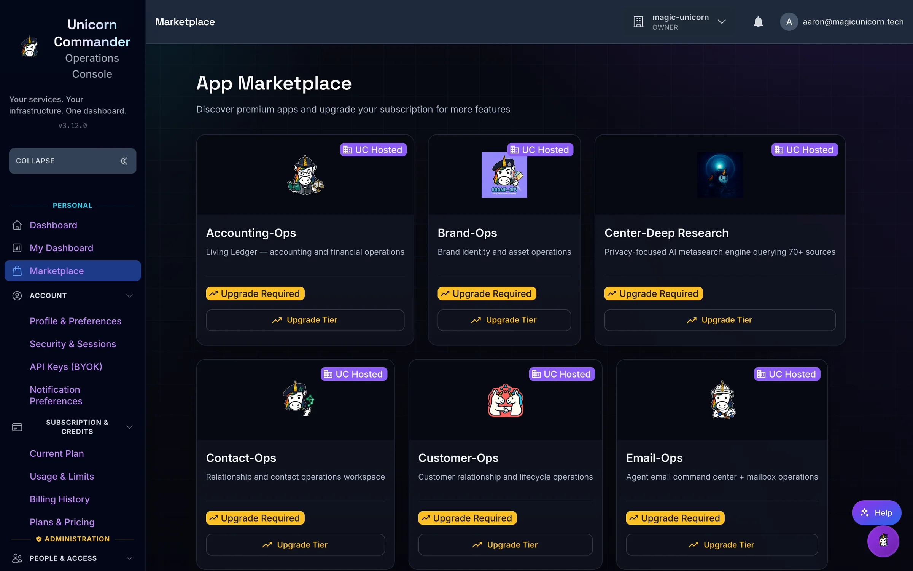
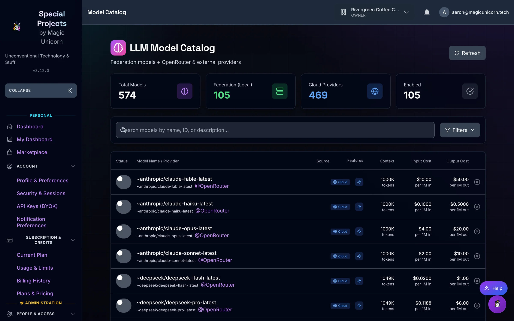
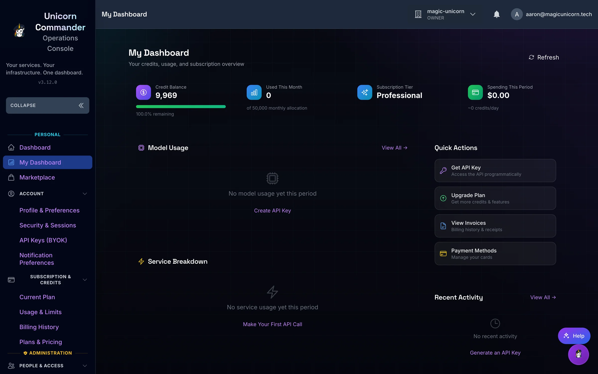
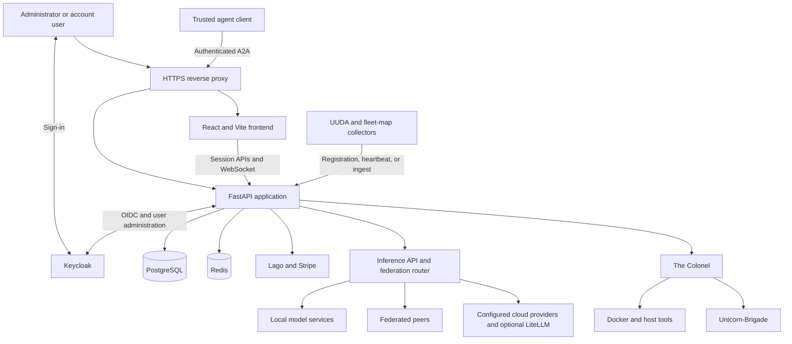

<p align="center">
  
</p>
<h1 align="center">Ops-Center</h1>
<p align="center">
  <strong>Run your AI services, tenants, billing, and agents from one self-hosted control plane.</strong>
</p>
<p align="center">
  <a href="LICENSE"></a>
  <a href="CHANGELOG.md"></a>
  <a href="package.json"></a>
  <a href="backend/requirements.txt"></a>
  <a href="#quick-start"></a>
  <a href="#built-for-agents"></a>
</p>
<p align="center">
  <a href="#quick-start">Quick start</a> ·
  <a href="#feature-tour">Features</a> ·
  <a href="#built-for-agents">Agents</a> ·
  <a href="#architecture">Architecture</a> ·
  <a href="#part-of-unicorn-commander">Suite</a>
</p>

<p align="center">
  
  <br><em>The admin dashboard — infrastructure and operations at a glance.</em>
</p>

## What is Ops-Center?

Ops-Center is the control plane for people running AI infrastructure and the applications built on it: manage users, organizations, subscriptions, API keys, model providers, and service health in one place. It is self-hosted and part of **Unicorn Commander**, whose apps connect through shared identity, organization context, entitlements, and usage APIs. **The Colonel**, its server-management agent, can inspect infrastructure and execute tools; its interactive chat asks humans to confirm actions marked as requiring approval. Choose local inference, federated capacity, or configured cloud providers according to your deployment and routing policy.

## Highlights

- **One place for accounts and access.** Manage Keycloak users, organization membership, roles, API keys, and app grants without maintaining separate access lists in every app.
- **Local inference with cloud options.** Manage model catalogs, provider credentials, and federated routing so applications can use a shared inference interface.
- **Usage attached to the account.** Track requests, credits, and model costs alongside subscriptions, invoices, and payment methods through Lago and Stripe integrations.
- **An agent that can act.** The Colonel exposes infrastructure skills through chat and authenticated A2A calls, including Docker inspection, logs, database diagnostics, and Brigade delegation.
- **Apps matched to entitlement.** The marketplace combines subscription features with organization grants, while users get a view of the apps they can access.
- **Infrastructure in context.** Follow service health, system metrics, federation topology, routing audits, and fleet inventory from the same dashboard.
- **A configurable platform.** Bring provider keys, curate app-specific model lists, customize branding, and configure billing exemptions for your installation.

## Feature tour

### Model and provider management

<p align="center">
  
  <br><em>Model and provider management — local inference with configured cloud failover.</em>
</p>

Manage local inference services and cloud provider connections, curate model lists per application, and control model access by tier. Bring Your Own Key (BYOK) settings let users supply their own provider credentials; platform keys and provider settings remain separate administrative surfaces. Account API keys are stored as bcrypt hashes.

The mounted inference surfaces are:

| Route | What it does |
|---|---|
| `POST /api/v1/llm/chat/completions` | OpenAI-compatible chat completions |
| `POST /api/v1/llm/image/generations` | Image generation, with cost rows for DALL-E and Stable Diffusion families |
| `POST /api/v1/inference/image/generate` | Image jobs proxied to Artwork Studio (FLUX) |
| `POST /api/v1/inference/music/generate` | Music jobs proxied to Majiks Studio (ACE-Step) |
| `POST /api/v1/audio/speech` | Text-to-speech proxy to a configured Kokoro service (`KOKORO_TTS_URL`) |
| `POST /api/v1/inference/audio/align` | Lyrics alignment and transcription jobs proxied to Artwork Studio |
| `POST /api/v1/metered/report` | Unit-metric reports for STT (`stt_audio_seconds`) and TTS (`tts_characters`). The audio does not pass through this route |
| `GET /api/v1/rag-services/status` | Embedding and reranker status. Start and stop are separate `POST` routes under `/api/v1/rag-services` |

Provider calls in the LLM API use configured base URLs for OpenAI, Anthropic, OpenRouter, Google, Ollama, and Ollama Cloud. [backend/model_adapters](backend/model_adapters) covers Ollama, vLLM, embeddings, and reranking. [litellm_config.yaml](litellm_config.yaml) lists additional cloud model entries and fallback groups. Which of these answer depends on the services and credentials you configure. The metered-compute module no longer proxies embeddings or reranking; those remain federation service types and RAG-service records.

**Routing and the gateway:** Ops-Center's inference API and federation router work alongside an optional LiteLLM proxy. Federation gathers local, peer, and cloud candidates, filters them against request constraints, and applies tier-dependent routing. With no tier, or when the tier is `vip_founder`, `founder_friend`, `admin`, or `internal`, the search order is local, then peer, then cloud. Any other named tier searches cloud GPU, then cloud, then local, then peer, unless the request sets `preferred_node`, which uses local, then peer, then cloud. A tier named `free` is not in that local-first allowlist. Configure and test fallback policy for your deployment before relying on it. When `FEDERATION_KEY` or `FEDERATION_SHARED_SECRET` is set, peer calls accept HMAC-SHA256 JWTs that expire in 60 seconds and carry a `jti` replay check, or that shared key. With no shared key configured, federation verification allows the request. `FEDERATION_AUTH_MODE` defaults to `shared_key`; `node_keys` is the other mode. The default per-peer circuit breaker opens after 3 consecutive failures, waits 30 seconds, and allows one half-open trial.

| Capability | What is implemented |
|---|---|
| App-specific catalogs | Curated model lists, ordering, tier access, and user preferences |
| Provider credentials | Platform keys and encrypted BYOK storage with key-testing actions |
| Shared inference | OpenAI-compatible chat completions and model discovery routes |
| Federation | Node registration, heartbeats, service discovery, topology, routing, and invocation |
| Routing resilience | Per-peer circuit breakers (default: 3 failures, 30 second cooldown, one half-open trial), routing audit records, and service access controls |
| Cloud GPU provisioning | Optional Lambda Labs and RunPod provisioning, instance tracking, and cleanup |
| Multi-step inference | Pipeline definitions that pass outputs between routed services |

See model-list management, the BYOK guide, and the [routing implementation](backend/federation/inference_router.py) for the configuration boundaries.

### Usage and metering

<p align="center">
  
  <br><em>Usage and metering — understand where requests and credits go.</em>
</p>

Inspect credit balances, ledger transactions, and recorded usage alongside account and organization billing. Lago supplies subscription and metering integration; Stripe supplies checkout, payment-method, invoice, and webhook flows. Plans and prices come from configured subscription tiers. If that lookup fails, the plan page shows a built-in list: Trial ($1/week), Starter ($19/month), Professional ($49/month), and Enterprise ($99/month). Those figures are the fallback, not the live catalog.

Users can review their plan, manage payment methods, and upgrade, downgrade, or cancel. Cancellation is recorded through Lago. Administrators can manage subscriptions, pricing, credit packages, and organization feature grants. Notification preferences are stored per user. The metered-compute reporting API also accepts usage from configured services, including audio workloads.

Some legacy analytics endpoints still generate sample data, and the Usage Metrics page falls back to demo charts when its API fails. Use the credit ledger and configured billing services to reconcile actual spend; a populated chart alone is not evidence of recorded usage.

For installations that do not charge for inference, the backend supports `BILLING_ENABLED` and `CREDIT_EXEMPT_TIERS`. These control inference credit checks; they do not provision or remove the billing services. See the [billing reference](docs/api/BILLING_API_REFERENCE.md) and [credit model](CREDITS.md).

### The app marketplace

<p align="center">
  
  <br><em>The app marketplace — discover applications and see your access.</em>
</p>

The marketplace uses app definitions and feature grants to present available applications. **My Apps** resolves subscription features together with organization grants, giving users a launcher for the services they can access. Administrators manage the catalog and the features associated with plans.

Keycloak-backed applications can share sign-in. App definitions contain launch URLs and access metadata; connecting an app still requires its own deployment, identity setup, and integration. Existing integrations include Brigade, Open-WebUI, Bolt.diy, Presenton, and Forgejo, with configurable catalog entries for other services.

### Service health

View Docker-backed service status, inspect logs, and manage service lifecycle operations on a configured host. System monitoring exposes CPU, memory, storage, and available GPU information; federation views show peer nodes and their advertised services. Host inspection and management require the relevant Docker, filesystem, and device access.

Additional administrative surfaces cover Traefik routes and certificates, storage and backups, alerts, website monitoring, and analytics. Optional Prometheus, Grafana, and Umami integrations use their configured services. Fleet inventory accepts UUDA registration and heartbeats, while the fleet-map integration ingests topology snapshots.

### Users, organizations, and access

The dashboard above is the entry point for account administration. Search and filter users, import and export CSV, change subscription tiers in bulk, assign or remove an individual realm role, and send password-reset or onboarding messages through Keycloak. Sign-in maps Keycloak groups and roles onto `admin`, `power_user`, `user`, and `viewer`. `GET /api/v1/admin/users/roles/available` returns a different hardcoded list: `admin`, `moderator`, `developer`, `analyst`, and `viewer`.

Organizations have membership and role-management APIs, settings, billing views, and feature grants. User details bring profile, access, organization, and subscription information together. Account API keys have creation, regeneration, revocation, and scope controls; service credentials support application-to-application calls. **The Guide**, described below, can prepare API-key create, revoke, and rotate actions that wait for a human confirmation.

Role checks, session authentication, and authorization remain part of the backend. User impersonation, the per-user activity feed, the per-user role list, bulk role assignment, and the administrative user-session endpoints are still placeholders in this checkout. Use the implemented routes and integration guide for the supported contract.

## Built for agents

### The Colonel: chat and A2A

The Colonel ships **18 skill definitions and 67 registered action executors**. These are Colonel function-calling actions, not a count of public MCP tools. The skill files use Markdown with YAML front matter and are loaded from [backend/colonel/skills](backend/colonel/skills).

Useful actions include:

| Action | Use it to |
|---|---|
| `system-status__full_status` | Inspect CPU, memory, disk, and GPU information |
| `docker-management__list_containers` | Discover containers and their state |
| `docker-management__container_logs` | Read a container's recent output |
| `service-health__check_all` | Check configured services |
| `postgresql-ops__stats` | Inspect database statistics |
| `litellm-management__list_models` | Inspect the configured proxy's model catalog |
| `brigade-delegation__list_agents` | Discover available Brigade agents |
| `brigade-delegation__delegate_task` | Send a task to a selected Brigade agent |

Interactive chat streams responses and tool activity over WebSocket, with Redis-backed sessions and PostgreSQL persistence. Actions marked for confirmation go through a human confirmation prompt in chat. Brigade registration and delegation use `BRIGADE_API_URL` and `BRIGADE_SERVICE_KEY`; the local memory graph can defer to Brigade when that integration is configured.

The mounted agent interface is **HTTP JSON-RPC at `/a2a`**:

- Discovery: `/.well-known/agent-card.json`, with a legacy card at `/.well-known/agent.json` and an agent index at `/.well-known/api-catalog`.
- Authentication: `Authorization: Bearer <a2a-shared-secret>` or `X-Service-Key: <a2a-shared-secret>`. The server uses `A2A_SHARED_SECRET`, falling back to `BRIGADE_SERVICE_KEY`, and refuses calls when neither is configured.
- Methods: `skills/list`, `skills/invoke`, `agent/status`, `colonels/list`, and the legacy `tasks/send`. `tasks/get` is not implemented; A2A streaming and push notifications are not advertised.
- Invocation: supply `skill`, `action`, and `parameters`. An optional `colonel` (or `colonel_id`) is stored on the audit row and selects the Colonel for `agent/status` and named agent cards. `skills/invoke` runs the shared executor map; it does not load a different tool set per Colonel.

**A2A is a privileged service interface.** Its direct `skills/invoke` handler calls executors without the interactive chat confirmation flow. Give its credential only to trusted callers and enforce any required human approval in that caller's workflow.

Copy this curl client configuration, replace the placeholders, and run it against your deployment to list available skills:

```bash
curl --config - <<'CURL'
url = "https://<ops-center-host>/a2a"
request = "POST"
header = "Authorization: Bearer <a2a-shared-secret>"
header = "Content-Type: application/json"
data = "{\"jsonrpc\":\"2.0\",\"id\":\"readme-discovery\",\"method\":\"skills/list\",\"params\":{}}"
silent
show-error
fail-with-body
CURL
```

For a read-only status action, change the JSON body to:

```json
{
  "jsonrpc": "2.0",
  "id": "readme-status",
  "method": "skills/invoke",
  "params": {
    "skill": "system-status",
    "action": "full_status",
    "parameters": {}
  }
}
```

### MCP discovery and application hooks

Ops-Center serves the suite MCP directory at `/.well-known/mcps.json`. It is a discovery index for other applications, not a general-purpose MCP server mounted by this app. MCP transport, authentication, and tool counts belong to each target server; inspect that server's discovery document and authenticated tool list before configuring a client. The committed directory contains deployment-specific locations and must be reviewed for your installation.

The main server does not mount the legacy MCP callback connector or the separate MCP metering and UUDA MCP gateway routers present in the source tree. Their presence is not a working public MCP endpoint, so there is no `mcpServers` configuration for Ops-Center itself here.

Other mounted hooks include API-key validation for applications, entitlement lookup, federation agent discovery and invocation, and service-authenticated metered-compute reporting. **The Guide**, a separate account assistant, provides account help and confirmation-based API-key lifecycle actions without the Colonel's host-management toolset.

See the [agent interface](backend/colonel/a2a_server.py), [skill router](backend/colonel/skill_router.py), and application integration guide.

## Quick start

### Docker: connect to a provisioned suite

**This checkout requires shared services.** Have PostgreSQL, Redis, Keycloak, and an HTTPS reverse proxy available before starting the authenticated dashboard. Billing needs Lago and Stripe configuration; inference and agent chat need configured model services or providers. The repository does not include a complete, portable suite bootstrap, and `SKIP_AUTH` in the environment template is not an implemented dashboard bypass.

The shortest self-contained application build uses the checked-in [Dockerfile](Dockerfile). Its frontend stage is Node 20, which is not the version in [.nvmrc](.nvmrc). The existing [direct Compose file](docker-compose.direct.yml) is a deployment-specific overlay: it expects external networks and services, references a prebuilt image, and includes embedded environment settings that override an env file. It needs operator review before reuse. The proxy Compose files do not create the backend, database, cache, or identity provider.

**Prepare your identity and storage services:**

- Provide an Ops-Center database and a database account able to apply its startup migrations. Review the [migration notes](backend/migrations/README.md); an existing database should be backed up before an upgrade.
- Provide Redis reachable from the application container. Configure both the split Redis settings and `REDIS_URL` consistently, including authentication.
- In Keycloak, create a confidential client whose client id is `ops-center`. The login, callback, and identity-provider hint routes hardcode that id in [backend/server.py](backend/server.py). Setting `OAUTH_CLIENT_ID` does not change it. Use the authorization-code flow. Register `https://<ops-center-host>/auth/callback` as its redirect URI and your HTTPS application origin as an allowed web origin. Put the client secret in `OPS_CENTER_OAUTH_CLIENT_SECRET`. If that variable is unset, the login handler uses a placeholder compiled into the same file.
- Make the user's roles or groups available to the user-info response. Assign the `admin` role or an `admins` group for the first administrator; the [role mapper](backend/role_mapper.py) lists supported mappings. `/auth/login/google`, `/auth/login/github`, and `/auth/login/microsoft` only add a Keycloak identity-provider hint. The providers still have to be enabled in the realm.
- Set `KEYCLOAK_REALM` to the realm that holds application users. If it is unset, `/auth/login` and the identity-provider hint routes default to `master`, and `/auth/callback` defaults to `uchub`.
- User-management calls request an admin token from the `master` realm with `KEYCLOAK_CLIENT_ID` (code default `admin-cli` when the variable is unset), `KEYCLOAK_ADMIN_USER`, and `KEYCLOAK_ADMIN_PASSWORD`. That request does not send `KEYCLOAK_CLIENT_SECRET`. Logout's end-session URL prefers `KEYCLOAK_CLIENT_ID`, then `OAUTH_CLIENT_ID`, then `ops-center`. The template sets `KEYCLOAK_CLIENT_ID=ops-center`, which matches the browser client and does not match the admin-token default. One variable serves both jobs in this checkout.
- Route your HTTPS application host to the application port, including `/auth`, `/api`, `/ws`, `/a2a`, and `/.well-known`. Preserve the original host and scheme and enable WebSocket forwarding.

Clone and prepare a private runtime configuration. On 2026-10-23 the public [Unicorn-Commander](https://github.com/Unicorn-Commander) organization did not list a repository named `Ops-Center`. Clone the URL of the checkout you are reading. The commands below assume the directory name `Ops-Center`.

```bash
git clone <repository-url>
cd Ops-Center
cp .env.example .env.auth
chmod 600 .env.auth
```

Edit `.env.auth` for your services before continuing. Replace the template's deployment defaults, credentials, and hostnames. Set the PostgreSQL, Redis, Keycloak, and optional provider variables listed under [Configuration](#configuration), and add these runtime settings missing from the template:

```dotenv
EXTERNAL_HOST=<ops-center-host>
EXTERNAL_PROTOCOL=https
OPS_CENTER_OAUTH_CLIENT_SECRET=<ops-center-client-secret>
SESSION_SECRET_KEY=<random-session-secret>
REDIS_URL=<authenticated-redis-url>
ENCRYPTION_KEY=<persistent-fernet-key>
BYOK_ENCRYPTION_KEY=<persistent-byok-fernet-key>
```

Use a hostname without a scheme or path for `EXTERNAL_HOST`. Keep encryption keys stable across restarts. The current SSO login and callback handlers construct an HTTPS redirect; a plain HTTP localhost address is useful for diagnostics, but is not the complete sign-in path.

Build and start the application on an **existing** Docker network that can reach your shared services. Replace `<suite-network>` with that network's name:

```bash
docker build --tag ops-center:local .

docker run --detach \
  --name ops-center \
  --network '<suite-network>' \
  --publish 127.0.0.1:8084:8084 \
  --env-file .env.auth \
  --mount type=volume,source=ops-center-data,target=/app/data \
  --mount type=volume,source=ops-center-avatars,target=/app/public/avatars \
  --entrypoint /bin/sh \
  ops-center:local \
  -c 'cp -a /app/dist/. /app/public/ && exec uvicorn server:app --host 0.0.0.0 --port 8084'
```

The startup command stages the newly built frontend into `public`, which the server checks before `dist`. The loopback port is for a reverse proxy on the Docker host; a containerized proxy on the same network can use the container's application port directly.

For host service inspection and control, add the Docker socket mount to that `docker run` command before the image name:

```text
--mount type=bind,source=/var/run/docker.sock,target=/var/run/docker.sock
```

Docker socket access grants control over the host's Docker daemon. GPU and host filesystem features need their own device or directory mappings; the basic application container does not automatically gain those capabilities.

Check that the backend responds, then complete sign-in through your configured HTTPS host:

```bash
curl --fail --silent --show-error http://localhost:8084/api/v1/system/status
docker logs --tail 100 ops-center
```

Open `https://<ops-center-host>/auth/login` and verify that the admin dashboard loads after Keycloak sign-in. A successful status response alone does not verify database initialization, authentication, billing, or inference. Review startup errors before enabling those integrations.

### Compose files in this repository

| File | Role |
|---|---|
| [docker-compose.direct.yml](docker-compose.direct.yml) | Application deployment overlay for existing suite networks and services |
| [docker-compose.traefik.yml](docker-compose.traefik.yml) | Static frontend behind Traefik |
| [docker-compose.prod.yml](docker-compose.prod.yml) | Nginx proxy on existing networks |
| [docker-compose.litellm.yml](docker-compose.litellm.yml) | Optional LiteLLM and routing services; references shared dependencies |
| [docker-compose.monitoring.yml](docker-compose.monitoring.yml) | Optional monitoring services |

These files describe separate deployment pieces. Review their mounts, service names, credentials, and external-network assumptions before combining them with your own suite deployment.

## Run from source

Use the Node version selected by [.nvmrc](.nvmrc), npm compatible with [package.json](package.json), and Python matching the backend's [Dockerfile](Dockerfile). Backend dependencies are in [backend/requirements.txt](backend/requirements.txt). The same database, cache, identity, and HTTPS prerequisites apply to source development.

From the repository root, install the frontend and backend dependencies:

```bash
npm ci
python3.10 -m venv .venv
. .venv/bin/activate
python -m pip install -r backend/requirements.txt python-dotenv
```

`python-dotenv` is not in [backend/requirements.txt](backend/requirements.txt). The `uvicorn --env-file` flag requires it.

Use the prepared `.env.auth`, with service addresses reachable from your development machine. Start the backend from the repository root:

```bash
. .venv/bin/activate
python -m uvicorn server:app \
  --app-dir backend \
  --env-file .env.auth \
  --host 127.0.0.1 \
  --port 8085 \
  --reload
```

In another terminal:

```bash
npm run dev -- --host 127.0.0.1
```

[Vite](vite.config.js) serves the frontend on `http://localhost:8084` and proxies `/api` and `/ws` to the backend on `8085`. It does not proxy `/auth`. For a full signed-in development session, route `/auth`, `/api`, `/ws`, `/a2a`, and `/.well-known` from your HTTPS development host to the backend, and other paths to Vite. Use that HTTPS host in Keycloak and `EXTERNAL_HOST`.

Build the frontend with:

```bash
npm run build
```

The build writes `dist/`. A locally built frontend is not automatically deployed by that command. For a container deployment, rebuild the image and use the Docker startup path above; source changes do not require copying a build into tracked assets.

## Configuration

[.env.example](.env.example) is a starting template, not a complete runtime contract. The table below lists important template variables read by the current integrations; fill in your own values in `.env.auth`.

| Variable | Meaning |
|---|---|
| `KEYCLOAK_URL` | Identity provider address reachable by the backend. Set it: the admin-token helper and the OAuth callback each compile a different fallback host |
| `KEYCLOAK_EXTERNAL_URL` | Browser-facing identity provider address, used for the login redirect and for user-info lookup |
| `KEYCLOAK_REALM` | Realm containing application users |
| `KEYCLOAK_CLIENT_ID` | Client id on the `master`-realm admin token request. When set, logout's end-session URL uses it too. The browser login id is hardcoded to `ops-center` |
| `KEYCLOAK_ADMIN_USER`, `KEYCLOAK_ADMIN_PASSWORD` | Credentials used by Keycloak administrative operations |
| `POSTGRES_HOST`, `POSTGRES_PORT` | PostgreSQL connection target |
| `POSTGRES_DB`, `POSTGRES_USER`, `POSTGRES_PASSWORD` | Application database and database credentials |
| `REDIS_HOST`, `REDIS_PORT`, `REDIS_DB`, `REDIS_PASSWORD` | Cache and session connection settings; keep consistent with the Redis URL |
| `LAGO_API_URL`, `LAGO_API_KEY` | Lago API connection and authentication |
| `STRIPE_PUBLISHABLE_KEY`, `STRIPE_SECRET_KEY`, `STRIPE_WEBHOOK_SECRET` | Checkout configuration, server API access, and webhook verification |
| `LITELLM_PROXY_URL`, `LITELLM_MASTER_KEY` | Optional LiteLLM proxy connection and administrative authentication |
| `RATE_LIMIT_ENABLED` | Enables the backend's configured rate-limiting integration |
| `UMAMI_URL` | Backend connection to the optional Umami analytics service |
| `VITE_UMAMI_WEBSITE_ID` | Build-time identifier enabling frontend Umami pageview tracking |
| `VITE_POSTHOG_KEY`, `VITE_POSTHOG_HOST` | Build-time PostHog project and ingestion configuration |

Additional settings used by current code but absent from the template:

| Variable | Meaning |
|---|---|
| `EXTERNAL_HOST`, `EXTERNAL_PROTOCOL` | Public application host and scheme used for URLs and cookie handling |
| `OPS_CENTER_OAUTH_CLIENT_SECRET` | Secret for the hardcoded browser client id `ops-center`. `OAUTH_CLIENT_ID` is only a logout fallback when `KEYCLOAK_CLIENT_ID` is unset |
| `SESSION_SECRET_KEY` | Persistent signing secret for session middleware |
| `REDIS_URL` | Redis connection URL used by session and credit-system initialization |
| `ENCRYPTION_KEY`, `BYOK_ENCRYPTION_KEY` | Persistent Fernet keys for credential and BYOK encryption |
| `BILLING_ENABLED`, `CREDIT_EXEMPT_TIERS` | Inference billing switch and exempt subscription tiers |
| `COLONEL_LLM_URL`, `COLONEL_MODEL`, `COLONEL_SERVICE_KEY` | Colonel inference endpoint, selected model, and service authentication |
| `COLONEL_PUBLIC_URL` | Public base URL advertised in Colonel discovery documents |
| `A2A_SHARED_SECRET` | Credential accepted by the Colonel's A2A endpoint |
| `BRIGADE_API_URL`, `BRIGADE_SERVICE_KEY` | Brigade registration and delegation connection |
| `COLONEL_LOCAL_GRAPH` | Whether the Colonel uses its local memory graph or defers to Brigade |
| `FEDERATION_NODE_ID`, `FEDERATION_ENDPOINT_URL`, `FEDERATION_PEERS` | Node identity, advertised endpoint, and peer configuration |
| `FEDERATION_KEY`, `FEDERATION_SERVICE_PROFILE` | Federation authentication material and service-discovery profile |
| `CLOUD_GPU_ENABLED`, `CLOUD_GPU_PROVIDER` | Optional cloud GPU provisioning switch and provider selection |

The template's `KEYCLOAK_CLIENT_SECRET` is not the browser-login secret. The login handler reads `OPS_CENTER_OAUTH_CLIENT_SECRET`, and the admin token request does not send `KEYCLOAK_CLIENT_SECRET`. Similarly, `ENABLE_BILLING`, `SECRET_KEY`, and `SKIP_AUTH` are not substitutes for `BILLING_ENABLED`, `SESSION_SECRET_KEY`, or a working Keycloak setup. Keep runtime configuration out of Git.

Frontend analytics initialize only in production builds with the corresponding build-time identifier configured. Changing container runtime variables alone does not alter an already compiled frontend; the stock Dockerfile does not pass these analytics variables into its frontend build stage.

## Architecture



- **Frontend — [src](src):** React, Vite, Material UI, React Router, context providers, and charting components. Admin, account, organization, billing, model, and federation pages share the application shell.
- **Application — [backend/server.py](backend/server.py):** FastAPI mounts the feature routers, handles browser sign-in and sessions, serves the frontend, and starts integration services.
- **Persistence:** PostgreSQL stores application and billing-related records; Redis supports sessions, caching, and coordination. Startup applies selected feature and core migrations; inspect the migration logs on deployment.
- **Identity and access:** Keycloak supplies identity. Browser login uses the hardcoded client id `ops-center`. Backend session checks, route-specific authorization, bcrypt-hashed API keys, and federation HMAC-SHA256 JWTs cover different entry points.
- **Inference — [backend/federation](backend/federation) and [backend/litellm_api.py](backend/litellm_api.py):** Provider routing, usage accounting, peer discovery, pipelines, and optional cloud GPU management.
- **Agents — [backend/colonel](backend/colonel):** Skill loading, execution, interactive confirmations, memory, sessions, and A2A integration. Brigade can provide delegation and agent memory.
- **Operations:** Docker, Traefik, billing providers, and monitoring services are external integrations. Compose describes deployment topology; it does not replace the services themselves.

<details>
<summary>Repository map</summary>

```text
Ops-Center/
├── backend/
│   ├── server.py                # Application, startup, auth, router registration
│   ├── colonel/                 # Agent chat, skills, memory, and A2A
│   ├── federation/              # Nodes, discovery, routing, and pipelines
│   ├── routers/                 # Infrastructure and integration APIs
│   ├── migrations/              # SQL migrations and migration manifest
│   ├── user_management_api.py   # Administrative user operations
│   ├── org_api.py               # Organizations and membership
│   ├── litellm_api.py           # Inference, usage, and provider operations
│   ├── my_apps_api.py           # App catalog and entitlement resolution
│   └── requirements.txt         # Python dependencies
├── src/
│   ├── App.jsx                  # Application shell and routes
│   ├── pages/                   # Admin and account pages
│   ├── components/              # Shared interface components
│   └── contexts/                # Shared frontend state
├── public/                      # Static assets
├── docs/                        # Guides, references, and historical reports
├── tests/                       # Integration and browser tests
├── Dockerfile                   # Frontend build and Python application image
├── package.json                 # Frontend version, dependencies, and commands
└── vite.config.js               # Frontend build and development proxy
```

</details>

## Part of Unicorn Commander

Public repositories on the [Unicorn-Commander](https://github.com/Unicorn-Commander) organization, checked 2026-10-23. Names below are the published repository names, not the product names used in older notes.

| App | From the public description |
|---|---|
| **Ops-Center** | **This repository. No public repository named `Ops-Center` was listed on that date** |
| [Unicorn-Stable](https://github.com/Unicorn-Commander/Unicorn-Stable) | Humans and agents in the same room |
| [Accounting-Ops](https://github.com/Unicorn-Commander/Accounting-Ops) | Append-only, hash-chained books |
| [Contact-Ops](https://github.com/Unicorn-Commander/Contact-Ops) | Shared contact and identity layer |
| [Customer-Ops](https://github.com/Unicorn-Commander/Customer-Ops) | Customer relationship and pipeline |
| [Email-Ops](https://github.com/Unicorn-Commander/Email-Ops) | Agent-governed mail with a human approval inbox |
| [Project-Ops](https://github.com/Unicorn-Commander/Project-Ops) | Projects and tasks |
| [Meeting-Ops](https://github.com/Unicorn-Commander/Meeting-Ops) | Record, live transcription, and meeting search |
| [Unicorn-Orator](https://github.com/Unicorn-Commander/Unicorn-Orator) | Text-to-speech |

Ops-Center connects through shared Keycloak identity, application entitlement and API-key validation APIs, and inference and metering services. This tree also registers and delegates the Colonel through Brigade, accepts UUDA device registration and heartbeats, and ingests fleet-map topology. On the date above, the public organization did not list repositories named Unicorn-Brigade, Knowledge-Ops, Security-Ops, Tax-Planning-Ops, Brand-Ops, Podcast-Ops, UUDA, or fleet-map.

## Development

Use [CONTRIBUTING.md](CONTRIBUTING.md) for the contribution workflow. The frontend manifest defines Vitest and Playwright commands; backend test configuration lives in [pytest.ini](pytest.ini), with extra dependencies in [tests/requirements-test.txt](tests/requirements-test.txt).

```bash
# Frontend tests, a single run
npm run test:run

# Production frontend build, including the dependency precheck
npm run build

# Backend test dependencies, in your activated virtual environment
python -m pip install -r tests/requirements-test.txt

# Backend tests: configure isolated test services before running the full suite
python -m pytest
```

Browser tests need a running test deployment and the fixtures required by the selected tests. Install the browser and explicitly select your test URL:

```bash
npx playwright install chromium
BASE_URL='https://<test-ops-center-host>' npm run test:e2e -- --project=chromium
```

Review the selected specs for additional service URLs and account requirements before execution. If `BASE_URL` is unset, [playwright.config.js](playwright.config.js) uses `https://magicunicorn.dev`. Some tests use other deployment-specific defaults. Use disposable test accounts and service instances.

The GitHub test workflow runs Ruff and Black from `backend/` as required steps, and MyPy with `continue-on-error`. It does not run Bandit. The GitHub CI/CD pipeline runs Ruff, Black, MyPy, and Bandit from `backend/`, each `continue-on-error`. The Forgejo CI/CD pipeline runs Ruff, Black, and MyPy from `backend/` with `|| true`; it installs Bandit and does not run it. Those three workflows install ESLint in the job and run it against `src`, with `continue-on-error` or `|| true`. `.forgejo/workflows/ci.yml` does not run these linters. There is no `npm run lint` script in the current manifest. Install Ruff explicitly for a local check:

```bash
python -m pip install ruff
python -m ruff check backend/
```

Frontend build and test commands above are available. This README does not imply that all application tests or lint checks currently pass.

### Documentation

Long-form references and historical implementation reports remain in the repository. Some predate the current routing and deployment model; use the current source and this README's startup prerequisites when a guide differs.

- [User guide](docs/USER_GUIDE.md) — account, dashboard, and administrative workflows.
- Application integration guide — identity, application access, and API integration.
- [Billing API reference](docs/api/BILLING_API_REFERENCE.md) and billing systems reference — billing surfaces and service relationships.
- [Credit model](CREDITS.md) — credit accounting concepts and billing terminology.
- Model-list reference — catalogs and per-app model access.
- BYOK user guide and [BYOK architecture](docs/BYOK_VS_PLATFORM_KEYS_ARCHITECTURE.md) — user and platform credential flows.
- [Traefik user guide](docs/TRAEFIK_USER_GUIDE.md) and [Traefik API reference](docs/TRAEFIK_API_REFERENCE.md) — routes, services, middleware, and certificates.
- [Monitoring setup](docs/MONITORING_SETUP.md) — optional monitoring infrastructure.
- [Migration notes](backend/migrations/README.md) and [SQL reference](backend/sql/README.md) — database setup and schema changes.
- [Legacy local-auth policy](docs/SECURITY_LEGACY_LOCAL_AUTH.md) — why local authentication is separate from Keycloak sign-in.
- [Tests](tests/README.md), [backend tests](backend/tests/README.md), and [browser tests](tests/e2e/README.md) — suite-specific fixtures and execution.
- [Troubleshooting](docs/TROUBLESHOOTING.md) — historical operational issues and diagnostics.
- Technical notes — detailed implementation context and deployment history.
- [Changelog](CHANGELOG.md) — release history. Entries that match this tree include campaign and invite-code work in 3.12.4, Brigade-aware Colonel memory (`COLONEL_LOCAL_GRAPH`) in 3.12.2, and the 3.12.0 inference notes for embeddings, reranking, and failover configuration. Earlier entries record federation routing, circuit breakers, routing audits, cloud GPU provisioning, and Colonel delegation to Brigade. Hostnames and hardware names in those notes are one installation's examples.
- Historical roadmap — planning context, not a statement of current completion.

The running FastAPI application also exposes `/docs` and `/openapi.json`. Those describe mounted routes more accurately than an old endpoint inventory; administrative session cookies, app API keys, service keys, and federation credentials serve different authentication paths.

### Troubleshooting the first run

| Symptom | Check |
|---|---|
| Login loops or a rejected callback | HTTPS host, Keycloak redirect URI, browser client ID and secret, and forwarded host/scheme |
| Login succeeds but admin access is denied | Keycloak user-info role/group claims and the role mapper |
| Empty data or failed feature pages | PostgreSQL connectivity, migration logs, Redis credentials, and the configured integration |
| UI works but host services are absent | Docker socket access, host mappings, service discovery, and GPU/device visibility |
| A model call fails | Provider availability, model naming, API-key scope, routing policy, and credit settings |
| An A2A call returns an authentication error | Shared-secret configuration and the presented service credential |
| A new frontend build does not appear | Which `public` or `dist` directory the application is serving |

For bugs and feature requests, use this repository's issue tracker. A public issues URL under `Unicorn-Commander/Ops-Center` was not listed on 2026-10-23. For general support, email [support@magicunicorn.tech](mailto:support@magicunicorn.tech).

Ops-Center builds on [FastAPI](https://fastapi.tiangolo.com/), [React](https://react.dev/), [Material UI](https://mui.com/), [Keycloak](https://www.keycloak.org/), [Lago](https://www.getlago.com/), and [LiteLLM](https://litellm.ai/).

## Security

Report vulnerabilities privately to [security@unicorncommander.ai](mailto:security@unicorncommander.ai); see [SECURITY.md](SECURITY.md) for what to include. Do not put credentials, personal data, or exploitable details in a public issue.

The implementation includes session authentication, route-level role checks, CSRF protection, rate limiting, hashed account API keys, encrypted provider credentials, and federation authentication and audit components. These have distinct scopes and configuration requirements. Terminate HTTPS at your proxy, restrict host-management access, and treat Colonel A2A credentials as privileged execution credentials.

## Licence

Ops-Center is licensed under the **GNU Affero General Public License, version 3 or any later version** (`AGPL-3.0-or-later`). See [LICENSE](LICENSE) for the full, unmodified licence text.

Copyright © Magic Unicorn Unconventional Technology & Stuff Inc.

Built by [Magic Unicorn](https://magicunicorn.tech) · part of [Unicorn Commander](https://unicorncommander.ai)
